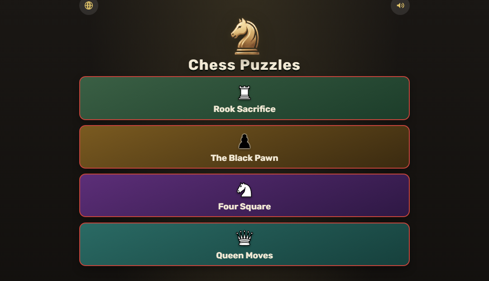
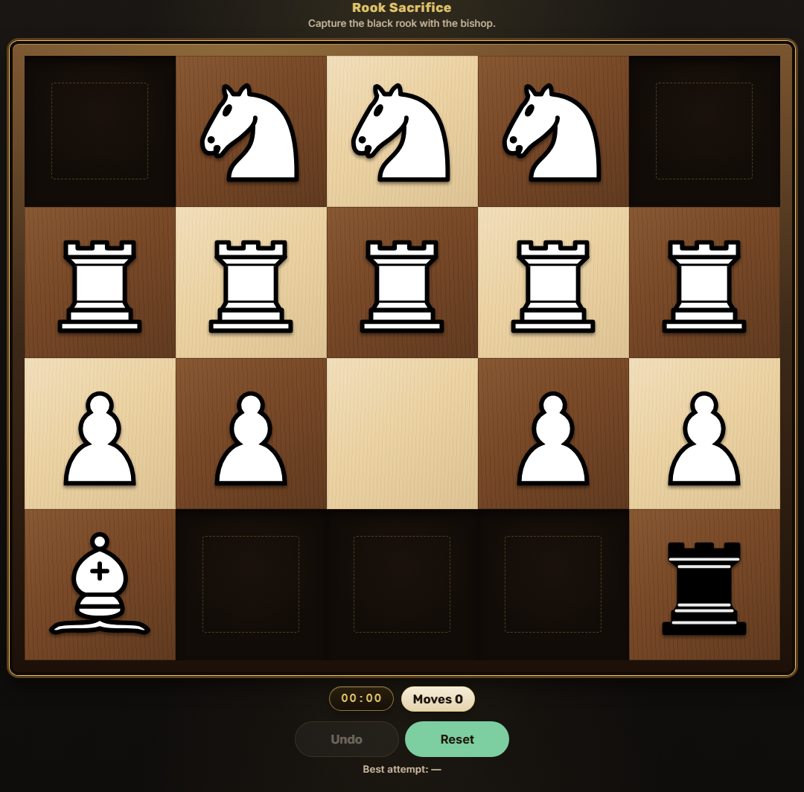

# Chess Puzzles

Android app of four single-player chess studies by Sherzod Khaydarbekov (2025).

<p align="center">
  
  
</p>

Pieces move as they do in chess. Blocked squares belong to the board. Each study has one objective and an author's line.

- **Rook Sacrifice.** The bishop captures the black rook.
- **The Black Pawn.** The knight captures the black pawn.
- **Four Square.** Place the knights, the bishops, and the rooks on the four red squares.
- **Queen Moves.** Bring the queen to the empty square and restore the rows: rooks on top, bishops below.

Package `com.metamovidas.chesspuzzles`. Version **1.0.18**. The project in `android-app/` is the app. The system navigation bar stays below the board.

```bash
npm ci
npm run apk
```

The Play Store keystore stays outside git.

English, Spanish, French, and Russian.
